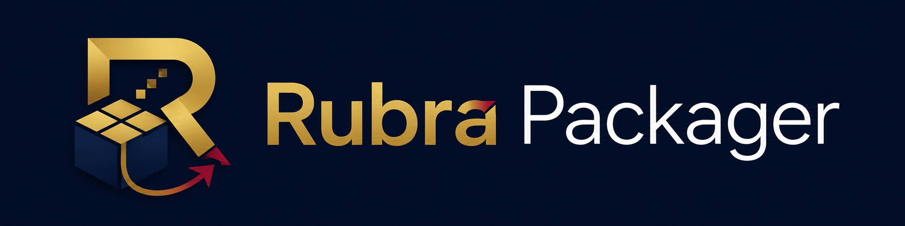

<p align="center">
  
</p>

# Rubra Packager

**Rubra Packager** is a Windows desktop release workshop for trusted local web and Python projects. It can turn project sources into Windows executables, export static web projects to Android, and turn already-built Windows artifacts into professional Inno Setup installers.

Rubra Packager began as an internal tool built to package our own applications and game builds. As the workflow matured, survived repeated real-world builds, and became useful beyond the project that created it, we separated it into an independent product, hardened the build paths, added its own UI and branding, and published the source.

**Stable release: v1.0.0**

## What it does

- **Web → Windows** — package an offline/static web application or game as a one-file Windows executable using PyWebView and PyInstaller.
- **Python → Windows** — build Python applications as ONEFILE or ONEDIR executables, GUI or console, with icons, hidden imports, data files and controlled dependency staging.
- **Web → Android** — package supported static web projects as Android APK builds through Node/npm, Capacitor-style project staging and Gradle/Android tooling.
- **Setup Builder** — turn an existing ONEFILE EXE or ONEDIR application folder into an Inno Setup installer with version, publisher, stable AppId, shortcuts and uninstall support.
- **Self release tools** — build Rubra Packager itself as a real Windows ONEDIR application plus a Setup installer.

## Design principles

- Local-first build workflow.
- Explicit trust before package-manager or project-controlled build execution.
- Project path confinement for Python entry points, data and search paths.
- Loopback-only local API protected by a per-launch token and origin checks.
- Separate frozen desktop application and private Python/PyInstaller build engine.
- No `shell=True` build execution in the Python source.

## Quick start from source

Requirements for the source checkout:

- Windows 10 or Windows 11;
- Python **3.11 or newer**;
- internet access for the first private-runtime preparation.

Clone the repository and run:

```text
run_windows.cmd
```

The launcher automatically creates or repairs the private source/build runtime under:

```text
%LOCALAPPDATA%\RubraPackager\runtime\.venv
```

Do **not** run Rubra Packager as Administrator.

See [User Guide](docs/USER_GUIDE.md) for the application workflows.

## Build Rubra Packager yourself

For a complete Windows Portable + Setup build, install **Inno Setup 6 or 7** and run:

```text
build_release_windows.cmd
```

The script prepares the source runtime when needed and writes generated artifacts under the ignored `release\` directory.

Expected output:

```text
release\
├── RubraPackager-1.0.0-Portable\
│   ├── RubraPackager.exe
│   └── _internal\...
├── RubraPackager-1.0.0-Portable.zip
├── RubraPackager-1.0.0-Setup.exe
├── rubra_packager-1.0.0-py3-none-any.whl
├── RubraPackager-1.0.0.release.json
└── SHA256SUMS.txt
```

`bootstrap_source_runtime.cmd` is intentionally kept separate from `build_release_windows.cmd`: the first owns one job — preparing/repairing the private source runtime — while the second owns the release build and calls the bootstrap only when required. This avoids duplicating environment-management logic.

Full instructions: [Building from source](docs/BUILDING.md).

## External dependencies

Core source/runtime dependencies:

- Python 3.11+;
- `pywebview>=5.0`;
- `pyinstaller>=6.10`;
- `Pillow>=10.0`.

Additional toolchains are only required for the corresponding targets:

| Target | Additional requirements |
| --- | --- |
| Web → Windows | Private Python build runtime prepared by Rubra Packager |
| Python → Windows | Private Python build runtime; project dependencies if explicitly trusted |
| Setup Builder | Inno Setup 6/7; optional winget bootstrap |
| Web → Android | JDK 17+, Android SDK, Node.js/npm |
| Rubra Packager release | Inno Setup 6/7 in addition to the core source requirements |

## Current limits

Rubra Packager v1.0.0 deliberately has a bounded scope:

- it is a **Windows desktop application**;
- web packaging targets offline/static applications; server backends, SSR servers and runtime APIs are not bundled;
- dynamic asset names that cannot be discovered statically may require a project manifest;
- Python dependency/project installation can execute project-controlled code and therefore requires explicit trust;
- Android output in the validated v1 workflow is aimed at APK/device builds; store publishing/signing workflows are not part of the v1 validation contract;
- macOS and Linux application packaging are not implemented;
- Authenticode signing is optional and requires your own certificate infrastructure.

## Repository policy

This repository contains the **source code and the tools required to build Rubra Packager**, but not compiled Portable/Setup releases. Generated `release/`, `build/`, EXE, APK, AAB, wheel and signing artifacts are intentionally ignored.

Official binary distributions are maintained separately from the source repository. See [Publishing policy](docs/PUBLISHING.md).

## Development path

The project evolved through a series of validated milestones:

- **RP-R4** — independent public foundation, new architecture/UI, security and preflight hardening;
- **RP-R5** — independent Python → Windows workflow;
- **RP-R6** — Windows Setup Builder;
- **RP-R7** — installer bootstrap and maintenance lifecycle;
- **RP-R8** — release engineering foundation;
- **v1 RC1–RC3** — metadata, real self-binary/runtime separation, branding and UI stabilization;
- **v1.0.0** — first stable public source release.

See [Development history](docs/DEVELOPMENT_HISTORY.md) and [CHANGELOG.md](CHANGELOG.md).

## Security

Rubra Packager is a build tool. Package managers and project build systems can execute code with your user permissions. Only enable npm/pip/project-install operations for sources you trust.

Read [SECURITY.md](SECURITY.md) before packaging unreviewed projects.

## License and provenance

Rubra Packager is distributed under the **Mozilla Public License 2.0**. See [LICENSE](LICENSE), [NOTICE.md](NOTICE.md) and [PROVENANCE.md](PROVENANCE.md).
